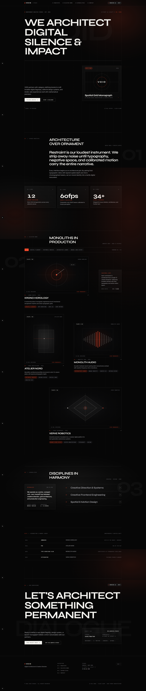

# VOID — Digital Creative Studio

**Frontend Engineering Mentorship · Class 1 (Exercise 1.1)**

> **Live Demo / Sitio en vivo / Demo ao vivo:** [https://voidstudio.falconit.xyz/](https://voidstudio.falconit.xyz/)

<p align="center">
  <a href="#english">English</a> ·
  <a href="#espanol">Español</a> ·
  <a href="#portugues">Português</a>
</p>



---

## <a id="english"></a>English

### About the Project

**VOID** is a premium digital creative studio website developed as part of **Class 1 of the Frontend Engineering Mentorship**. The project explores high-craft creative frontend architecture, pairing brutalist Swiss minimalism with fluid responsiveness, layered spatial depth, and calibrated motion.

- **Live Deployment:** [https://voidstudio.falconit.xyz/](https://voidstudio.falconit.xyz/)

### Key Architectural Highlights

- **Fluid `clamp()` Responsiveness:** Typography, gutters, grid gaps, card padding, and vertical section rhythm scale seamlessly across viewports via CSS `clamp()` tokens.
- **12-Column CSS Grid + Flexbox Architecture:** Outer section alignment and vertical cadence are managed with Flexbox, while every section's editorial composition is strictly structured on a 12-column CSS Grid.
- **GSAP Tween Micro-Transitions & Depth Layers:** Compositor-only GSAP tweens (`transform`, `opacity`, `clip-path`) scoped with `@gsap/react` (`useGSAP`), `ScrollTrigger`, and `gsap.matchMedia()` power masked headline reveals, discipline filters, accordions, scroll progress, an editorial pointer companion, and multi-plane depth layers (`back`, `mid`, `front`).
- **Static Monograph Routes & API Endpoint:** Statically generated case studies (`/work/[slug]` via `generateStaticParams`), a custom brutalist `404` page, SEO metadata (`robots.ts`, `sitemap.ts`), and a validated `POST /api/inquiry` Route Handler connected to the inquiry drawer.
- **Performance & Accessibility First:** React Server Components by default, `next/font` zero-CLS font loading, WCAG 2.1 AA+ contrast tokens, keyboard navigation (`Escape`, focus management, skip link), and full `prefers-reduced-motion` support.

### Tech Stack & Tools

| Category | Tools |
| :--- | :--- |
| **Framework** | [Next.js 16 (App Router + Turbopack)](https://nextjs.org/) & [React 19](https://react.dev/) |
| **Language** | [TypeScript](https://www.typescriptlang.org/) (`strict` mode) |
| **Styling & Layout** | [Tailwind CSS v4](https://tailwindcss.com/), CSS Custom Properties (`clamp()`), 12-Column CSS Grid & Flexbox |
| **Animation** | [GSAP](https://gsap.com/) (`ScrollTrigger`, `quickTo`, `matchMedia`) & [`@gsap/react`](https://gsap.com/resources/React/) |
| **Utilities** | `clsx`, `tailwind-merge`, `next/font` (`Syne`, `Inter`, `JetBrains Mono`) |
| **Quality & Tooling** | ESLint (`eslint-config-next`), TypeScript Compiler (`tsc --noEmit`) |

### Getting Started

```bash
# Install dependencies
npm install

# Run local development server
npm run dev

# Run typecheck, linter, and production build
npm run typecheck
npm run lint
npm run build
```

---

## <a id="espanol"></a>Español

### Sobre el Proyecto

**VOID** es el sitio web de un estudio creativo digital premium desarrollado en la **Clase 1 de la Mentoría de Frontend Engineering**. El proyecto aborda la arquitectura creativa frontend moderna, combinando minimalismo editorial de inspiración suiza con diseño fluido, capas de profundidad espacial y movimiento calibrado.

- **Sitio en vivo:** [https://voidstudio.falconit.xyz/](https://voidstudio.falconit.xyz/)

### Pilares Técnicos y de Diseño

- **Diseño Responsive Fluido con `clamp()`:** Toda la escala tipográfica, márgenes, separación de grilla, padding de tarjetas y ritmo vertical entre secciones escalan de forma continua mediante `clamp()`.
- **CSS Grid de 12 Columnas + Flexbox:** Flexbox organiza el ajuste y la alineación externa de cada sección, mientras que CSS Grid de 12 columnas gobierna la composición editorial interna para lograr impacto visual y minimalismo.
- **Microtransiciones con GSAP Tweens y Capas de Profundidad:** Animaciones sobre propiedades de compositor (`transform`, `opacity`, `clip-path`) gestionadas con `@gsap/react` (`useGSAP`), `ScrollTrigger` y `gsap.matchMedia()` para revelados enmascarados, filtros de proyectos, acordeones, barra de progreso, puntero editorial y planos de profundidad (`back`, `mid`, `front`).
- **Monografías Estáticas y Endpoint de Contacto:** Páginas de caso de estudio generadas estáticamente (`/work/[slug]` con `generateStaticParams`), página `404` editorial, SEO técnico (`robots.ts`, `sitemap.ts`) y Route Handler `POST /api/inquiry` con validación en servidor conectado al formulario lateral.
- **Rendimiento y Accesibilidad:** Arquitectura orientada a React Server Components, carga optimizada de fuentes con `next/font`, contraste verificado WCAG 2.1 AA+, navegación por teclado (`Escape`, *skip link*, foco visible) y soporte completo para `prefers-reduced-motion`.

### Herramientas y Tecnologías Utilizadas

| Categoría | Herramientas |
| :--- | :--- |
| **Framework** | [Next.js 16 (App Router + Turbopack)](https://nextjs.org/) y [React 19](https://react.dev/) |
| **Lenguaje** | [TypeScript](https://www.typescriptlang.org/) (modo `strict`) |
| **Estilos y Layout** | [Tailwind CSS v4](https://tailwindcss.com/), variables CSS con `clamp()`, CSS Grid (12 cols) y Flexbox |
| **Animaciones** | [GSAP](https://gsap.com/) (`ScrollTrigger`, `quickTo`, `matchMedia`) y [`@gsap/react`](https://gsap.com/resources/React/) |
| **Utilidades** | `clsx`, `tailwind-merge`, `next/font` (`Syne`, `Inter`, `JetBrains Mono`) |
| **Calidad y Verificación** | ESLint (`eslint-config-next`), TypeScript (`tsc --noEmit`) |

### Ejecución Local

```bash
# Instalar dependencias
npm install

# Iniciar servidor de desarrollo
npm run dev

# Verificar tipos, lint y build de producción
npm run typecheck
npm run lint
npm run build
```

---

## <a id="portugues"></a>Português

### Sobre o Projeto

**VOID** é o website de um estúdio criativo digital premium desenvolvido na **Aula 1 da Mentoria de Frontend Engineering**. O projeto explora a arquitetura frontend criativa moderna, unindo minimalismo editorial suíço, responsividade fluida, camadas de profundidade espacial e microtransições precisas.

- **Projeto ao vivo:** [https://voidstudio.falconit.xyz/](https://voidstudio.falconit.xyz/)

### Destaques de Arquitetura e Design

- **Responsividade Fluida com `clamp()`:** Tipografia, margens laterais, espaçamentos da grade, padding de cartões e ritmo vertical das seções se adaptam continuamente a qualquer tela usando `clamp()`.
- **CSS Grid de 12 Colunas + Flexbox:** O Flexbox controla o alinhamento externo e o fluxo das seções, enquanto o CSS Grid de 12 colunas define a composição editorial interna de cada seção com equilíbrio minimalista e alto impacto visual.
- **Microtransições com GSAP Tweens e Camadas de Profundidade:** Tweens de alta performance (`transform`, `opacity`, `clip-path`) gerenciados com `@gsap/react` (`useGSAP`), `ScrollTrigger` e `gsap.matchMedia()` para revelação de textos, filtros de portfólio, acordeões, barra de progresso de rolagem, ponteiro editorial e planos de profundidade (`back`, `mid`, `front`).
- **Estudos de Caso Estáticos e API de Contato:** Páginas de monografia geradas estaticamente (`/work/[slug]` via `generateStaticParams`), página `404` personalizada, SEO técnico (`robots.ts`, `sitemap.ts`) e Route Handler `POST /api/inquiry` validado no servidor e integrado ao drawer de contato.
- **Performance e Acessibilidade:** Arquitetura baseada em React Server Components, carregamento otimizado de fontes com `next/font`, contraste verificado WCAG 2.1 AA+, navegação por teclado (`Escape`, *skip link*, foco visível) e suporte completo a `prefers-reduced-motion`.

### Stack e Ferramentas Utilizadas

| Categoria | Ferramentas |
| :--- | :--- |
| **Framework** | [Next.js 16 (App Router + Turbopack)](https://nextjs.org/) e [React 19](https://react.dev/) |
| **Linguagem** | [TypeScript](https://www.typescriptlang.org/) (modo `strict`) |
| **Estilização e Layout** | [Tailwind CSS v4](https://tailwindcss.com/), variáveis CSS com `clamp()`, CSS Grid (12 colunas) e Flexbox |
| **Animação** | [GSAP](https://gsap.com/) (`ScrollTrigger`, `quickTo`, `matchMedia`) e [`@gsap/react`](https://gsap.com/resources/React/) |
| **Utilitários** | `clsx`, `tailwind-merge`, `next/font` (`Syne`, `Inter`, `JetBrains Mono`) |
| **Qualidade e Verificação** | ESLint (`eslint-config-next`), TypeScript (`tsc --noEmit`) |

### Como Executar Localmente

```bash
# Instalar dependências
npm install

# Executar servidor de desenvolvimento
npm run dev

# Verificar tipagem, lint e build de produção
npm run typecheck
npm run lint
npm run build
```

---

<p align="center">
  <strong>VOID Studio</strong> — Frontend Engineering Mentorship · Class 1
</p>
